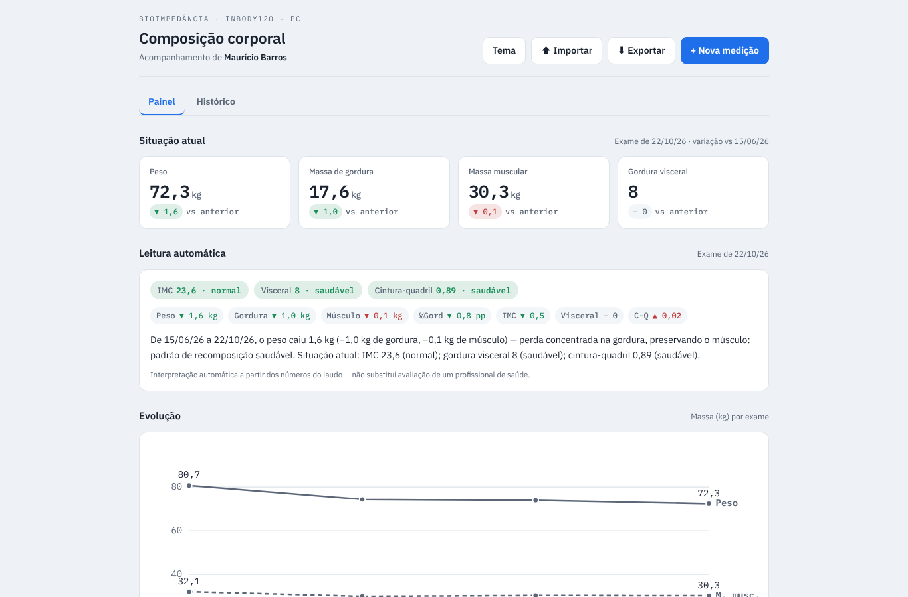

# InBody — Composição Corporal

App de uma página para acompanhar exames de bioimpedância **InBody120** ao longo do tempo: painel com a situação atual, leitura automática dos indicadores, gráfico de evolução, histórico e exportação.

## O problema

Cada laudo InBody120 é uma folha A4 com a foto de **um único momento**. Com os laudos guardados em PDF, em pastas diferentes, não dá para enxergar a tendência: o peso caiu por perda de gordura ou de músculo? A gordura visceral voltou à faixa saudável?

## O que o app faz

- **Situação atual:** peso, massa de gordura, massa muscular e gordura visceral do último exame, com a variação em relação ao anterior.
- **Leitura automática:** classifica IMC, gordura visceral e relação cintura-quadril contra as faixas de referência e escreve a interpretação da mudança (por exemplo, "perda concentrada na gordura, preservando o músculo").
- **Evolução:** gráfico de peso, gordura e massa muscular por exame.
- **Histórico** com inclusão, edição e exclusão de medições.
- **Exportação** em JSON (backup), CSV (planilha) e relatório Markdown com as interpretações.
- Os dados ficam no navegador (`localStorage`); nada é enviado para servidor.

## Resultado com os dados reais (4 exames, nov/2025 a out/2026)

| Indicador | 21/11/2025 | 22/10/2026 | Variação |
| --- | --- | --- | --- |
| Peso (kg) | 80,7 | 72,3 | −8,4 |
| Massa de gordura (kg) | 22,8 | 17,6 | −5,2 |
| % de gordura | 28,3 | 24,4 | −3,9 pp |
| IMC | 26,4 (sobrepeso) | 23,6 (normal) | −2,8 |
| Gordura visceral (nível) | 10 | 8 | volta à faixa ≤ 9 |
| Massa muscular esquelética (kg) | 32,1 | 30,3 | −1,8 |

O app aponta o ponto de atenção que a leitura isolada de um laudo esconde: a massa muscular caiu entre nov/2025 e fev/2026 e só recuperou parte depois.

## Como usar

1. Abra `inbody-pc.html` no navegador (ou pelo GitHub Pages, se ativado).
2. Clique em **Importar** e escolha um dos arquivos `inbody_dados_*.json`, ou use **+ Nova medição** para digitar um laudo.

## Arquivos

| Arquivo | Conteúdo |
| --- | --- |
| `inbody-pc.html` | O app completo (HTML, CSS e JavaScript num único arquivo) |
| `inbody_dados_*.json` | Exames no formato de importação/backup do app |
| `inbody_planilha_2026-10-28.csv` | Os 4 exames em planilha |
| `inbody_relatorio_*.md` | Relatórios gerados pelo app |
| `InBody120 — Visão inicial e arquitetura do app.md` | Análise do laudo, modelo de dados e riscos (OCR, LGPD) |

> A interpretação automática parte dos números do laudo e não substitui a avaliação de um profissional de saúde.

**Autor:** Maurício Barros · [Portfólio](https://opusvix.github.io/) · [LinkedIn](https://www.linkedin.com/in/mauriciodasilvabarros/)
